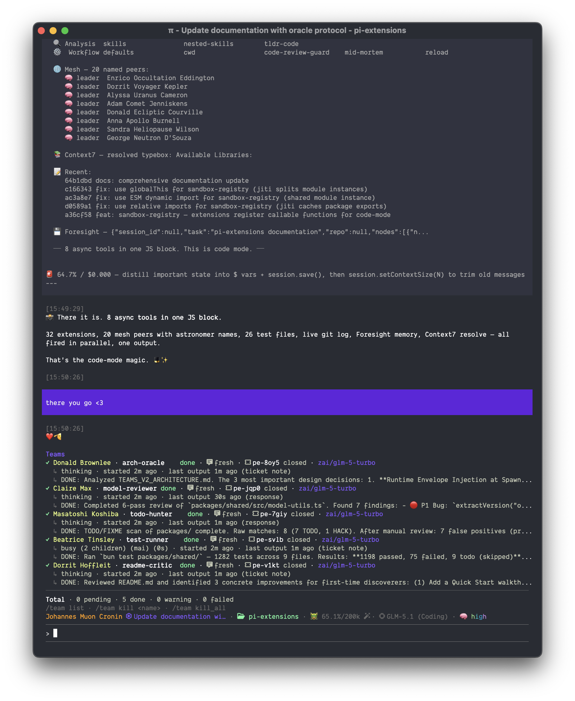

<p align="center">
  
  <h1 align="center">💄 pi-extensions <sup style="text-transform:super;"
  >(for bananas 🍌)</sup></h1>
</p>

<p align="center"><strong>32 extensions that makes pi <code>bananas</code>, faster, and multi-agent.</strong></p>

<p align="center">
  <a href="#install">Install</a> · <a href="#packages">Packages</a> · <a href="https://github.com/earendil-works/pi-mono">pi</a>
</p>

---

**pi-extensions** is a flat monorepo of extension packages for [pi](https://github.com/earendil-works/pi-mono). Each package does one thing. Install what you need, skip what you don't.

## What you get

- **Code mode** — write JS that calls 8 (whatever, or 200) tools in parallel from a single block, with variable passthrough between blocks, session management- more whatever. Heavy work (cold builds, deploys, long pipelines) can run async — the TUI stays interactive while the result delivers as a follow-up turn.
- **Mesh networking** — P2P agent communication with zero servers (Zenoh via bun:ffi), between sessions or teams.
- **Teams** — spawn worker agents across different models, collect results, do work, more whatever ⌨️🐒
- **Git safety** — blocks destructive commands, tracks AI authorship
- **Fast file search** — Rust-native frecency-ranked search
- **Code intelligence** — semantic search, call graphs, dead code detection
- **32 packages total** — UI, prompts, themes, workflow, and more

## Install

One package:

```bash
pi install ./packages/brave-search
pi install ./packages/pi-mesh
```

Full workspace (run once after changing dependencies):

```bash
pi install git:https://github.com/cygnusfear/pi-extensions
```

> **Heads up — this workspace is bun-only.** [`@ff-labs/fff-bun`](packages/fff/) declares `engines.bun >=1.0.0` and ships a bun-specific postinstall, so the install fails under plain `npm install`. If `pi install` shells out to npm and fails with `Bun's postinstall script was not run`, clone manually and run `bun install` instead:
>
> ```bash
> # pi install will still clone into ~/.pi/agent/git/...
> cd ~/.pi/agent/git/github.com/cygnusfear/pi-extensions
> bun install
> # then register the packages you want in ~/.pi/agent/settings.json:
> #   "git/github.com/cygnusfear/pi-extensions/packages/<name>"
> ```
>
> Make sure [bun](https://bun.sh) is on your PATH (`bun --version`).

> **If you're on nix-installed Node, also fix the npm global prefix first.** Pi 0.74+ runs `npm install -g <pkg>` for any `npm:`-scoped entry in `settings.json` `packages: [...]`. The default prefix on nix is read-only (`/nix/store/...`), so every spawn fails with `EACCES` and workers crash with `npm install -g <pkg> failed with code 243`. Fix once per machine:
>
> ```bash
> mkdir -p ~/.npm-global
> echo 'prefix=/Users/<you>/.npm-global' >> ~/.npmrc
> ```
>
> Then restart any running pi coordinator — it caches `process.env` at start, so the new prefix only takes effect for fresh processes.

Each package is independently installable, testable, and removable via `~/.pi/agent/settings.json` or project `.pi/settings.json`.

## Packages

### Core Tools

| Package                                      | Description                                                              |
| -------------------------------------------- | ------------------------------------------------------------------------ |
| [code-mode](packages/code-mode/)             | `execute_code` sandbox — write JS calling tools as typed async functions |
| [file-tools](packages/file-tools/)           | `apply_patch` edits + `readImage` for image viewing                      |
| [hashline-tools](packages/hashline-tools/)   | Verified file editing with hashline anchors (rejects on file change)     |
| [fff](packages/fff/)                         | Fast file search via fff-bun subprocess (frecency-ranked)                |
| [background-bash](packages/background-bash/) | Run long-lived bash commands without blocking the agent                  |
| [webfetch](packages/webfetch/)               | Fetch URLs as text/markdown/HTML (max 5MB)                               |
| [context7](packages/context7/)               | Up-to-date library docs via Context7 MCP                                 |

### Agent Communication

| Package                      | Description                                                                    |
| ---------------------------- | ------------------------------------------------------------------------------ |
| [pi-mesh](packages/pi-mesh/) | P2P agent communication via Zenoh — peer discovery, direct messaging, channels |
| [teams](packages/teams/)     | Multi-agent delegation — spawn workers, assign tasks, collect results          |

### Memory & Context

| Package                                            | Description                                                        |
| -------------------------------------------------- | ------------------------------------------------------------------ |
| [ouija](packages/ouija/)                           | Session-history search — raw conversations, dead sessions, BM25 recall |
| [context](packages/context/)                       | TUI view showing loaded extensions, skills, context usage          |
| [worktree-summaries](packages/worktree-summaries/) | Injects current worktree path into context for compaction survival |

### Model & Prompt

| Package                                        | Description                                                        |
| ---------------------------------------------- | ------------------------------------------------------------------ |
| [model-shortcuts](packages/model-shortcuts/)   | Slash commands for quick model switching (`/opus`, `/zai`, etc.)   |
| [model-hints](packages/model-hints/)           | Injects latest available models into system prompt                 |
| [default-prompt](packages/default-prompt/)     | Default system prompt — always injected                            |
| [prompt-templates](packages/prompt-templates/) | Bundled slash-command templates (`/cmd.handoff`, `/cmd.wtf`, etc.) |

### Git & Safety

| Package                            | Description                                          |
| ---------------------------------- | ---------------------------------------------------- |
| [git-safety](packages/git-safety/) | Blocks destructive git commands, protects `.git/`    |
| [git-ai](packages/git-ai/)         | Tracks AI-authored code via git-ai agent-v1 protocol |

### UI & Display

| Package                                          | Description                                             |
| ------------------------------------------------ | ------------------------------------------------------- |
| [powerline-footer](packages/powerline-footer/)   | Powerline-style status bar + welcome overlay            |
| [lipgloss-theme](packages/lipgloss-theme/)       | Custom TUI theme                                        |
| [core-edit-ui](packages/core-edit-ui/)           | Shiki syntax-highlighted diffs for the edit tool        |
| [core-read-ui](packages/core-read-ui/)           | Collapsible UI + timing for the read tool               |
| [notify](packages/notify/)                       | Desktop notification when agent finishes (OSC 777)      |
| [session-tab-title](packages/session-tab-title/) | Tab title = stage icon + topic + agent identity (`status()`) |
| [image-links](packages/image-links/)             | Clickable `file://` links for images (OSC 8 hyperlinks) |

### Session Control

| Package                            | Description                                                |
| ---------------------------------- | ---------------------------------------------------------- |
| [lock-mode](packages/lock-mode/)   | `/lock` disables all write tools — read-only mode          |
| [reload](packages/reload/)         | `reload_runtime` tool — agents call pi's built-in `/reload` |
| [fork-fixes](packages/fork-fixes/) | Extension-level fork patches (drops orphaned tool results) |

### Skills & Analysis

| Package                                  | Description                                                         |
| ---------------------------------------- | ------------------------------------------------------------------- |
| [skills](packages/skills/)               | Skills package manager CLI wrapper                                  |
| [nested-skills](packages/nested-skills/) | Discovers nested SKILL.md files pi's scanner missed                 |
| [tldr-code](packages/tldr-code/)         | Semantic code search, call graphs, dead code detection via llm-tldr |

### Workflow

| Package                                          | Description                                                               |
| ------------------------------------------------ | ------------------------------------------------------------------------- |
| [defaults](packages/defaults/)                   | Directory-aware read, AGENTS.md discovery, git rebase helper, auto naming |
| [cwd](packages/cwd/)                             | Change session base directory (`/cwd <path>`)                             |
| [code-review-guard](packages/code-review-guard/) | Injects code health prompt after code-reading tool results                |
